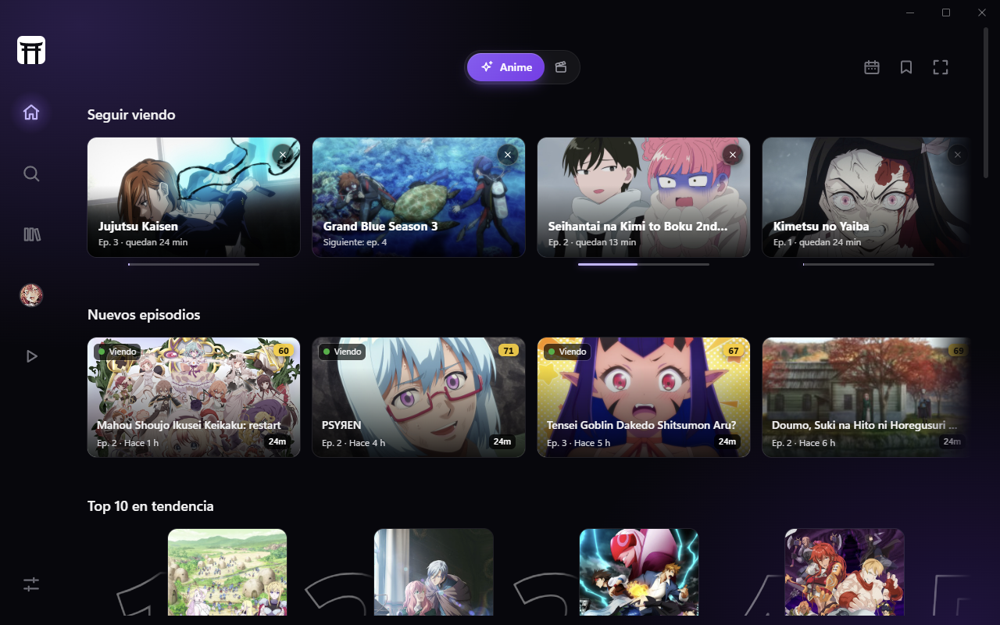
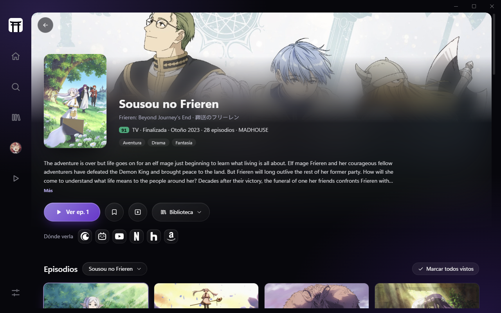
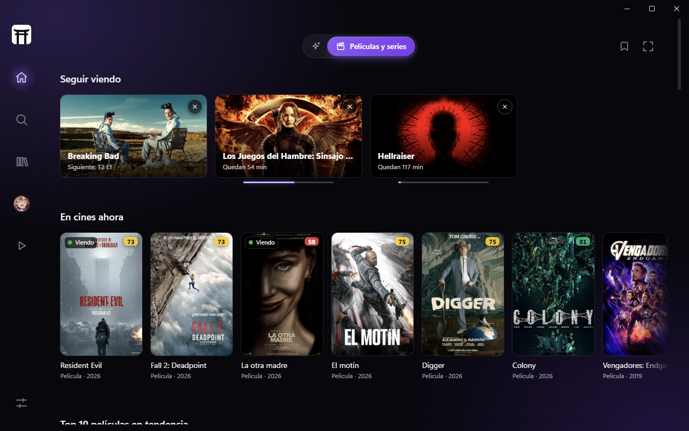
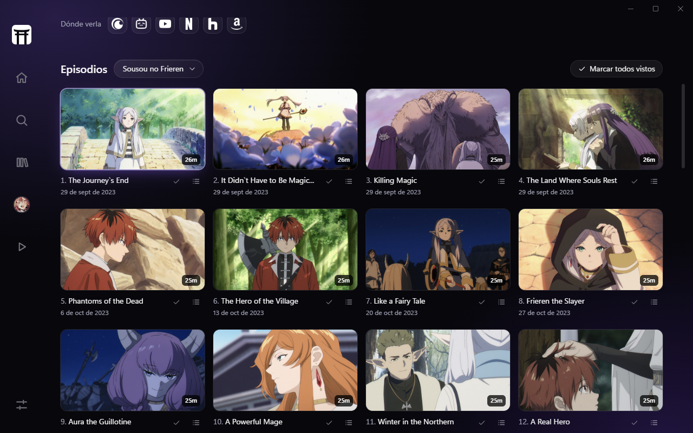
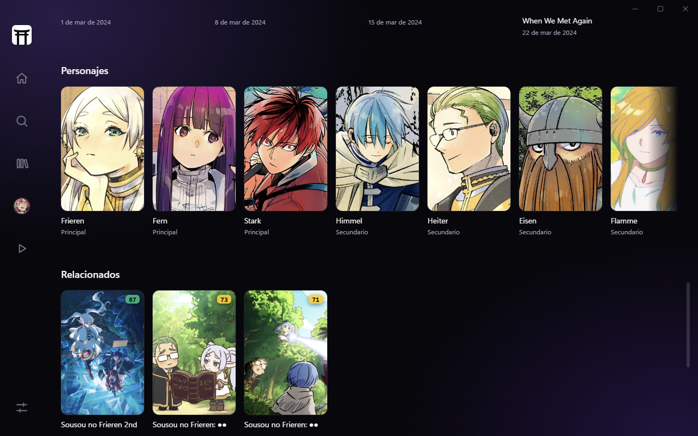
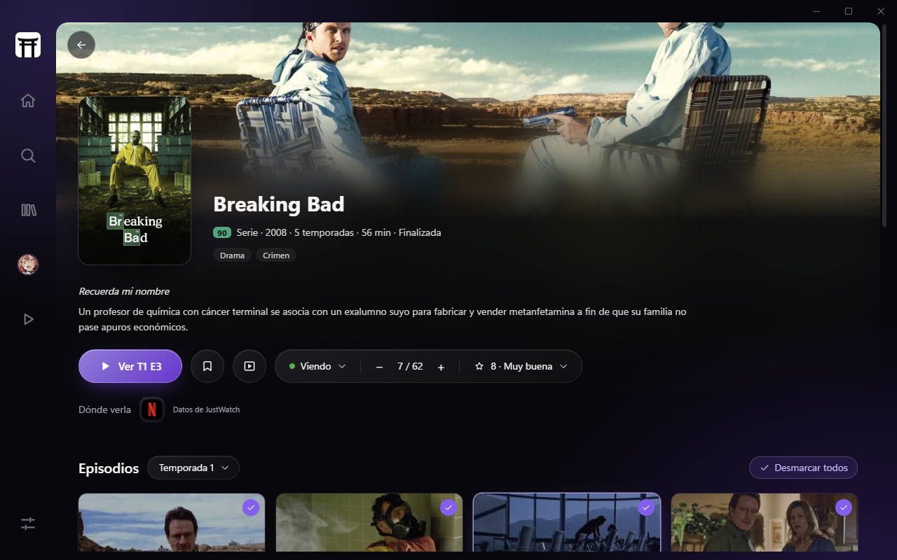
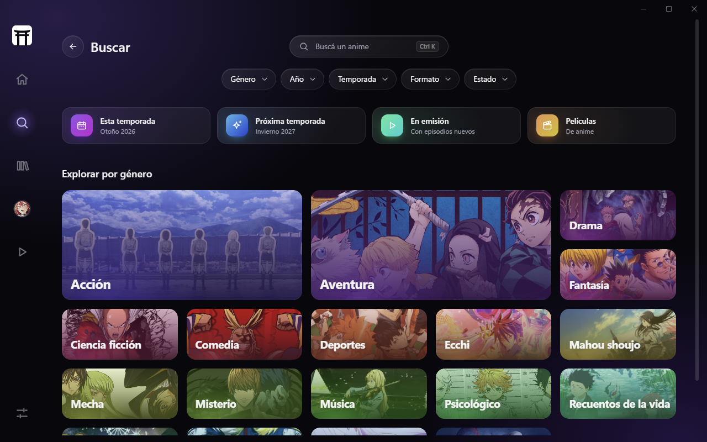
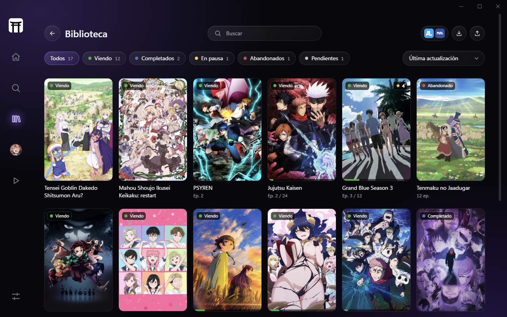
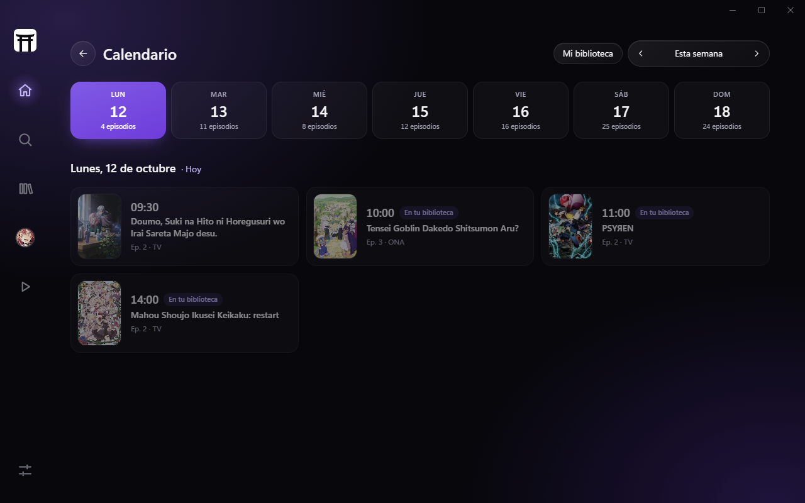

  

<h1 align="center">Torii</h1>

  App gratuita para Windows para llevar tu anime, tus películas y tus series: catálogo con fichas, episodios y personajes, tu biblioteca sincronizada con AniList o MyAnimeList, y un reproductor propio.

  <a href="https://github.com/torii-app-zz/torii-releases/releases/latest"><b>Descargar la última versión</b></a>

Torii no trae contenido ni fuentes: reproduce tus archivos o lo que agregues vos.

## Qué tiene

- **Inicio** con Seguir viendo, los episodios nuevos de lo que ves, el Top 10 en tendencia y la temporada en emisión. Anime por un lado; películas y series por otro.
- **Fichas** con episodios, personajes, relacionados, recomendaciones, tráiler y dónde verla en servicios legales.
- **Buscar** por nombre, género, año, temporada, formato y estado.
- **Calendario** de la semana, con lo de tu biblioteca marcado.
- **Biblioteca** con estados, puntaje y carpetas, sincronizada con AniList o MyAnimeList, y **Amigos** para ver sus listas.
- **Reproductor** con subtítulos a tu estilo, audio a elección, saltar opening y ending, y el siguiente episodio solo.

## Capturas

| Anime | Películas y series |
| --- | --- |
|  |  |

| Episodios | Personajes |
| --- | --- |
|  |  |

| Ficha de una serie | Buscar |
| --- | --- |
|  |  |

| Biblioteca | Calendario |
| --- | --- |
|  |  |

## Descargar

Bajá `Torii_<versión>_x64-setup.exe` de la [última versión](https://github.com/torii-app-zz/torii-releases/releases/latest).

Funciona en Windows 10 y 11 de 64 bits, en español o en inglés.

## Instalar

1. Abrí el instalador.
2. Si aparece "Windows protegió su PC" (el instalador todavía no está firmado), tocá **Más información** y después **Ejecutar de todas formas**.
3. Seguí los pasos. Si a tu Windows le falta WebView2, el instalador lo baja.

Torii se actualiza sola: cuando hay una versión nueva, te avisa, y con un clic se instala y vuelve a abrir.

## Legal

Los términos de uso y la política de privacidad están en la app, en Ajustes → Información.

El catálogo de anime viene de AniList, y el de películas y series de TMDB. Este producto usa la API de TMDB, pero no está avalado ni certificado por TMDB.

Contacto: toriiappzz@gmail.com
